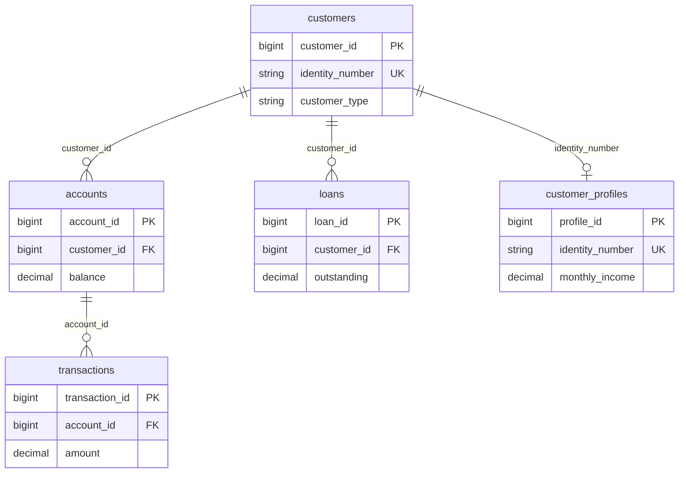

# Mô hình nguồn

Hạt dữ liệu lần lượt: một khách hàng, một tài khoản, một giao dịch chuẩn, một hồ sơ CRM, một khoản vay. `identity_number` là chuỗi `FICTIONAL-ABC-...`, ổn định qua hệ thống. CRM không chứa customer_id. Mặc định một hồ sơ khớp cho mỗi khách; cấu hình số hồ sơ thấp hơn hoặc tiêm thiếu hồ sơ tạo quan hệ 1:0..1 và được ghi rõ trong manifest. Không tạo hồ sơ mồ côi.

Khóa BIGINT dương, liên tục trong batch đầu. profile_id dùng miền riêng bắt đầu 1000000001. Batch sau thêm khóa lớn hơn khóa cũ; cập nhật giữ nguyên khóa. Khóa ngoại luôn tồn tại sau khi áp dụng toàn bộ batch. Chỉ raw_delivery được phép lặp transaction_id.
