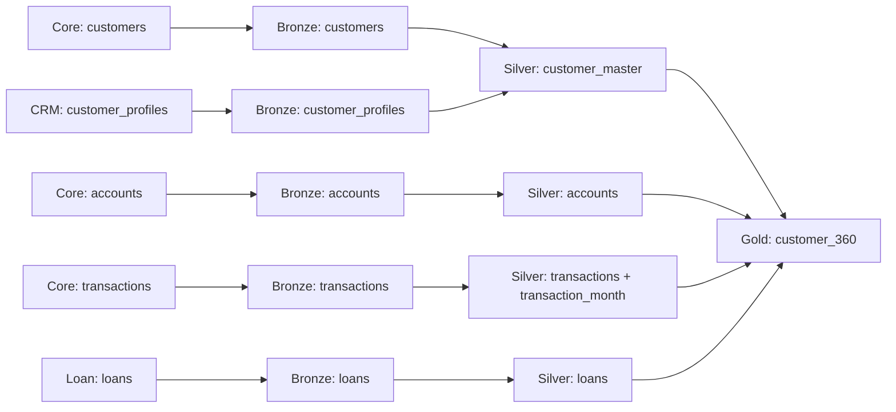

# Mô hình đích dự kiến

Chỉ đặc tả, không tạo bảng Bronze/Silver/Gold hoặc chạy chuyển đổi.

Bronze giữ nguyên năm schema nguồn và thêm `_source_system STRING NOT NULL`, `_ingested_at TIMESTAMP UTC NOT NULL`, `_batch_id STRING NOT NULL`. Ingested_at là lúc nhận, không dùng thay updated_at của nguồn. Raw delivery phải khử trùng trước khi tính chỉ tiêu.

Silver customer_master có customer_id làm PK, toàn bộ cột customers, cộng phone/email/address/occupation/monthly_income từ CRM và `profile_updated_at`; cập nhật chung bằng max thời gian của hai nguồn. Các bảng Silver khác giữ schema và PK/FK nguồn; transactions thêm `transaction_month STRING` dạng YYYY-MM. Chuẩn hóa phone về chuỗi `+84-SYN-...`; giữ NULL cho giá trị thiếu. DECIMAL không chuyển qua DOUBLE.

Gold có khóa customer_id, hạt đúng một dòng mỗi khách và mốc snapshot_date. Phải tổng hợp riêng accounts, loans, transactions theo khách trước khi ghép để tránh nhân bản. Toàn bộ định nghĩa cột, NULL và kiểu dữ liệu ở từ điển và bảng ánh xạ.
