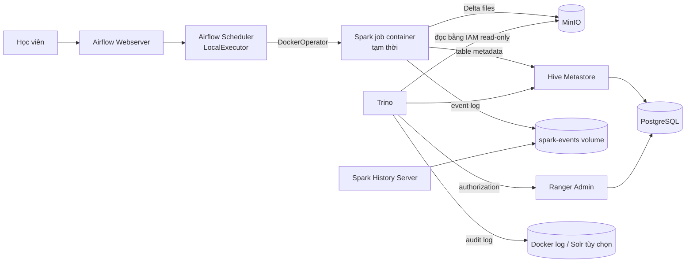

# Kiến trúc hạ tầng Phase 2

Phase 2 dựng một lakehouse cục bộ, có trạng thái bền vững nhưng compute Spark theo từng tác vụ. Luồng mặc định không cần Spark Master/Worker chạy thường trực.

| Thành phần | Trách nhiệm | Trạng thái |
|---|---|---|
| PostgreSQL | Metadata Airflow, Hive Metastore và Ranger; DB nguồn tùy chọn | Volume riêng, không mở cổng host |
| MinIO | `raw`, `warehouse`, `spark-logs`; IAM tách Spark/Trino/admin | Volume riêng, chỉ bind `127.0.0.1` |
| Hive Metastore | Catalog chung cho Spark và Trino | Thrift nội bộ cổng 9083 |
| Spark | Ghi Delta, MERGE và đăng ký bảng | Container tạm thời, `local[N]` mặc định |
| Airflow | Điều phối bằng LocalExecutor + DockerOperator | Chỉ scheduler được mount Docker socket |
| Spark History Server | Đọc event log hoàn tất | Không chạy Spark job |
| Trino | SQL đọc Delta | `READ_ONLY` ở base; `SYSTEM` khi Ranger bật |
| Ranger | Query/table/column/mask/filter policy | Override bảo mật, không bắt buộc cho base |
| Solr | Tìm kiếm audit Ranger | Chỉ profile audit |

## Compose module

- `infra/compose.yaml`: nền tảng base.
- `infra/compose.security.yaml`: Ranger, TLS/password cho Trino và test quyền.
- `infra/compose.audit.yaml`: Solr cho audit có thể tìm kiếm.
- `infra/compose.distributed.yaml`: Spark standalone chỉ dùng khi chủ động học phân tán.
- `infra/compose.sources.yaml`: khởi tạo DB nguồn tùy chọn.

Named volume giữ metadata và object qua `down`. Chỉ `reset` xóa volume. Network nội bộ có tên từ `DOCKER_NETWORK_NAME`; cổng host mặc định chỉ lắng nghe loopback.

## Ranh giới tin cậy

Docker daemon tương đương quyền quản trị máy lab. Người có quyền vào Docker socket, đọc `.env`, inspect container hoặc mount volume có thể vượt qua Ranger và MinIO IAM. Mô hình này chứng minh kiểm soát ở lớp truy vấn và object identity, không phải sandbox chống quản trị viên host.
