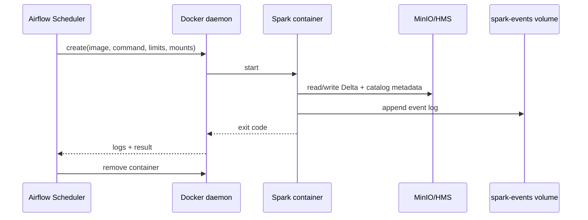

# Airflow và Spark container tạm thời

Airflow dùng `LocalExecutor`, nhưng mỗi tác vụ xử lý Spark là một `DockerOperator`. Scheduler tạo container từ `SPARK_IMAGE`, truyền command dạng mảng (không qua shell), gắn network, job volume read-only và event-log volume read-write. Khi job kết thúc, `auto_remove=force` xóa container.



Factory `infra/airflow/plugins/spark_docker_operator.py` chỉ chấp nhận:

- job Python dưới `/opt/spark/jobs`;
- master `local[N]` hoặc master phân tán của lab;
- memory đúng dạng `1024m`/`4g`;
- một tập prefix Spark config cho phép;
- CPU trong khoảng 0,5–16.

Credential S3 đi qua environment, không nằm trong command/log. Chỉ scheduler mount `/var/run/docker.sock`; webserver không có quyền này. Airflow pool `spark_tasks` mặc định một slot tránh nhiều driver cạnh tranh RAM.

DAG `infrastructure_smoke_test` tạo bảng theo `run_id`, rồi chạy create, append, MERGE và validate trong bốn container riêng. Tác vụ Python sau đó so giá trị cụ thể qua Trino và kiểm tra event log. Dọn container thất bại còn sót:

```bash
make cleanup-spark
```

Lệnh chỉ xóa container có label `customer360.ephemeral=true`.
