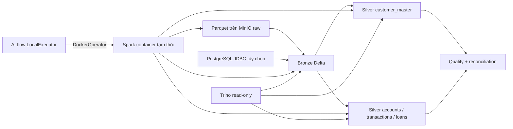

# Kiến trúc Phase 3

Airflow chỉ điều phối. Mỗi tác vụ nặng chạy bằng Spark container tạm thời, sử dụng job volume và event-log volume của Phase 2. Mặc định chỉ một Spark task chạy trong pool `spark_tasks`. Hive Metastore đăng ký bảng Delta có location rõ ràng trên `s3a://warehouse`; Trino chỉ kiểm tra và đối soát.

File mode là mặc định. Mixed mode đọc customers/accounts qua PostgreSQL, CRM qua PostgreSQL đã được Phase 2 xác minh, transactions từ raw delivery và loans từ Parquet. Hai mode dùng cùng transformation code.
